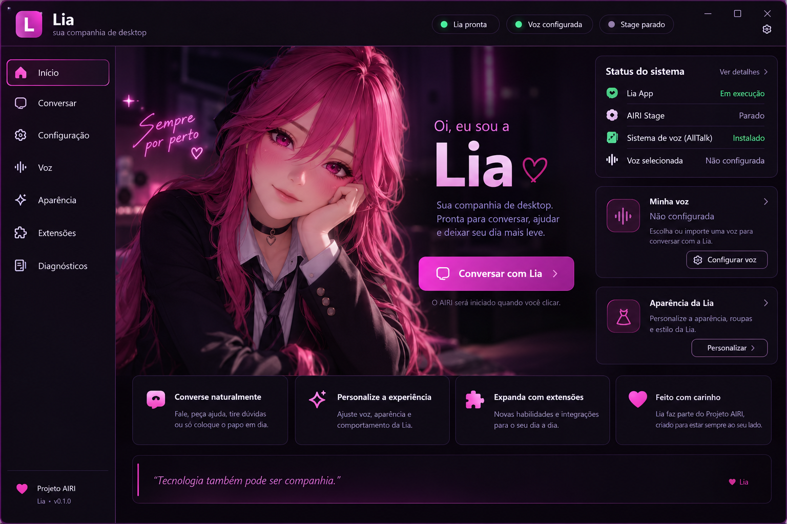

<p align="center">
  
</p>

<h1 align="center">Lia Desktop</h1>

<p align="center">
  <strong>Sua companheira digital, com voz, memória e presença no computador.</strong><br>
  Uma experiência pessoal de IA para Windows, construída para respeitar o controle da pessoa sobre seus dados e suas ações.
</p>

<p align="center">
  <a href="#o-que-a-lia-faz">Funcionalidades</a> ·
  <a href="#como-experimentar">Começar</a> ·
  <a href="#estado-do-projeto">Estado atual</a> ·
  <a href="docs/README.md">Documentação</a>
</p>

> **Prévia de desenvolvimento para Windows.** O código do Launcher e do Stage é próprio da Lia e os fluxos principais possuem validações em Electron/Windows. Ainda não existe uma release pública estável deste repositório.

## Conheça a Lia

A Lia combina conversa, voz, uma personagem visual e contexto pessoal em uma única experiência. Você pode falar com um modelo configurado por você, usar a presença do avatar no desktop e decidir quais memórias e capacidades ficam disponíveis. O objetivo é evoluir para uma assistente útil no dia a dia — sem tratar sugestões de IA como autorização para agir.

<p align="center">
  <br>
  <sub>Concept de direção artística. Não representa necessariamente a interface da build atual.</sub>
</p>

## O que a Lia faz

| Experiência | Disponível na prévia |
| --- | --- |
| **Conversa com IA** | Chat com provedores configuráveis, incluindo rotas locais, histórico de conversas e controles de envio. |
| **Voz** | Gravação e transcrição, síntese e reprodução de respostas; opções locais e serviços configurados explicitamente. |
| **Avatar e presença** | Importação de VRM local, expressões e janela de presença independente, inclusive com suporte a segundo monitor. |
| **Personalidade** | Perfil e traços editáveis, preservados no armazenamento local do produto. |
| **Memória pessoal** | Notas opt-in com escopos global, projeto e conversa; edição, exclusão e contexto autorizado. |
| **Notas Markdown** | Conexão voluntária de pasta por projeto, busca local somente leitura, origem por arquivo/linha e revogação. |
| **Capacidades supervisionadas** | Catálogo do Lia Agent Hub e operação `skill.validate` com confirmação, grant temporário, acompanhamento e auditoria. |

**Importante:** notas Markdown recuperadas são exibidas como texto literal no painel Memória; não são enviadas automaticamente para o chat. A validação de Skills verifica estrutura e diagnósticos, **não** aprova a segurança de uma Skill nem a executa. O avatar 3D canônico da personagem ainda não foi produzido.

## Como experimentar

O caminho de desenvolvimento é o **Windows**. Tenha Node.js e Corepack disponíveis e, na raiz do repositório, abra:

```powershell
.\Lia.bat
```

O script prepara os pacotes necessários e abre o **Launcher Lia**. Selecione **Conversar com Lia** para iniciar o **Stage**, onde ficam chat, memória, voz e avatar. Para preparar sem abrir a janela:

```powershell
.\Lia.bat -PrepareOnly
```

Para executar a validação do produto a partir do código:

```powershell
powershell -NoProfile -File .\lia\Test-Lia.ps1 -Prepare
```

Esses comandos são de **desenvolvimento**, não links para um instalador público. Dependências e serviços opcionais podem exigir instalação ou configuração separada. Consulte [o estado operacional](docs/project/CURRENT-STATE.md) antes de usar a prévia.

## Privacidade e controle

A Lia é projetada com armazenamento local, memória opcional, confirmação antes de operações sensíveis e separação entre dados do usuário e instruções de modelos. Provedores remotos, quando configurados, podem receber os dados necessários à requisição autorizada. A presença de uma interface de permissão não substitui a validação de segurança de cada integração.

## Estado do projeto

**Em desenvolvimento ativo.** A arquitetura própria de Launcher, Stage e runtime está em uso; voz, memória, presença e `skill.validate` já possuem código e testes. Permanecem em evolução a experiência visual definitiva, a integração de mais capacidades, a validação com dispositivos e provedores externos e a distribuição pública.

- [Estado atual e gates](docs/project/CURRENT-STATE.md)
- [Visão e especificação do produto](docs/product/ESPECIFICACAO-GERAL-DO-PRODUTO-LIA.md)
- [Arquitetura e decisões](docs/architecture/LIA-ARCHITECTURE.md)
- [Padrões de marca](docs/BRAND-STANDARDS.md)

## Ecossistema Lia

A Lia Desktop é a companheira pessoal. O [Lia Forge](https://github.com/BloomRX/Lia-Forge) produz assets; o [Lia Studio](https://github.com/BloomRX/Lia-Studio) apoia a criação de jogos; o [Lia Agent Hub](https://github.com/BloomRX/Lia-AgentHub) organiza capacidades; e o [Lia Go](https://github.com/BloomRX/Lia-Go) cuida de viagens em grupo. São produtos independentes, com identidade visual compartilhada.

## Desenvolvimento, créditos e licenças

Quem for contribuir ou operar agentes deve começar por [`AGENTS.md`](AGENTS.md), [`lia/README.md`](lia/README.md) e pelo [índice técnico](docs/README.md). **O README é uma apresentação do produto, não uma instrução de execução para agentes.**

O [Project AIRI](https://github.com/moeru-ai/airi) é uma origem e referência histórica; a Lia Desktop atual usa sua implementação própria. Consulte os [avisos de terceiros](docs/licenses/THIRD-PARTY-NOTICES.md) e as [licenças de assets](docs/licenses/ASSET-LICENSES.md). Nome, personagem e identidade visual da Lia não devem ser confundidos com a licença de componentes de código.
